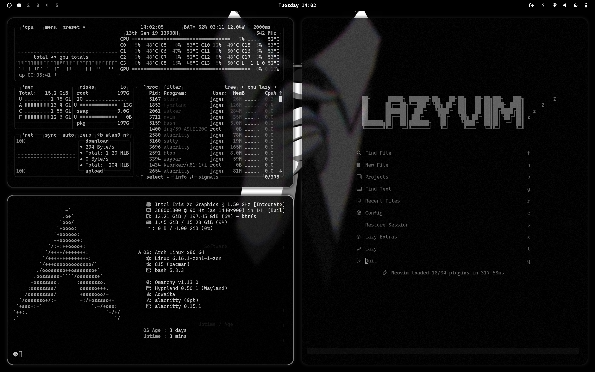

# nodaysidle Monolith — Omarchy Theme

> *"Monochromatic austerity, bone chalk contrast, pure focus."*

A radical brutalist monochrome theme for **Omarchy / Hyprland**, custom-tailored for the **nodaysidle** ecosystem. Inspired by **anonymous** and architectural brutalism.

Designed to eliminate chromatic distraction so syntax, system architecture, and terminal output stand out with absolute clarity. Background windows dim dramatically into the darkness to keep attention locked on the active task.



---

## Design System & Color Tokens

Anchored in a deep pitch onyx carbon ground with high-contrast bone chalk white highlights and grayscale hierarchy:

| Token | Hex | Role in Ecosystem |
| :--- | :--- | :--- |
| **Pitch Onyx** | `#050505` | Deep carbon black ground (distraction-free base) |
| **Stealth Surface** | `#111215` | Elevated surfaces, menu cards, and container acrylic |
| **Bone Chalk** | `#FFFFFF` | Active window border, primary beacon, active focus |
| **Chalk White** | `#EDEDED` | Main typography & active headers (JetBrains Mono) |
| **Subdued Slate** | `#888890` | Secondary typography & border gradient transitions |
| **Charcoal Carbon** | `#222429` | Inactive window borders, sunken separators |
| **Muted Ash** | `#55555C` | Line numbers, code comments, subtle metadata |
| **Alert Red** | `#FF4B4B` | Minimalist urgency & critical notifications |

---

## Key Architectural Features

### 1. High-Contrast Depth Isolation
`inactive_opacity = 0.72` and `dim_strength = 0.25` push background windows into the darkness, illuminating only the active task for monastic focus.

### 2. Brutalist Squircle Geometry
Window geometry balances raw architectural brutalism with soft squircle edges (`rounding = 10`, `rounding_power = 2.8`), accompanied by subtle matte blur (`passes = 2, size = 3`).

### 3. Ghostty & Herdr Cockpit Integration
Engineered from the ground up for **Ghostty** and the **Herdr** agent workspace multiplexer:
- Ghostty palette config with pure white cursor and chalk selection highlights
- Live hot-reload support (`SIGUSR2`) on theme switch
- Matched window rules for `com.mitchellh.ghostty` and `title = "^Herdr.*"`

### 4. Bespoke Top Menu Bar Surfaces
`shell.toml` configures a brutalist, distraction-free status bar:
- **Pitch Onyx Bar**: `background = "#050505"` with near-opaque `alpha = 0.98`
- **Bone Chalk Rim**: Razor-thin border (`#222226`) separating the bar from the workspace
- **Monochrome Nodes**: Active workspaces and telemetry stats rendered in `#FFFFFF`

### 5. Curated High-Resolution Wallpapers
Includes 6 bespoke brutalist & architectural monochrome wallpapers:
- `01-monolith-anonymous-dark.png`: Stealth Anonymous geometric dark.
- `02-monolith-anonymous-contrast.png`: High-contrast chalk grid.
- `03-monolith-brutalist-concrete.png`: 4K monolithic brutalist concrete structure.
- `04-monolith-architectural-monolith.png`: 4K high-contrast geometric stone monolith.
- `05-monolith-twisted-stairs.png`: Pitch-black architectural stairs.
- `06-monolith-layers-stacked.png`: Pure minimalist dark stacked layers.

---

## Installation & Activation

### 1. Register the Theme
Clone and run the installer from inside the repository:

```bash
git clone https://github.com/nodaysidle/omarchy-theme-nodaysidle-monolith.git
cd omarchy-theme-nodaysidle-monolith
chmod +x install uninstall hooks/nodaysidle-monolith
./install
```

### 2. Activate with Omarchy
```bash
omarchy theme set nodaysidle-monolith
```

### 3. Cycle Wallpapers
```bash
omarchy theme bg next
```
*(or press `Super + Ctrl + Space` for the visual wallpaper picker)*

---

## File Architecture

```
omarchy-theme-nodaysidle-monolith/
├── colors.toml               # Master color tokens for Omarchy templates
├── hyprland.lua              # 110° bone chalk gradient, 10px squircle, monolith snap
├── shell.toml                # Monolithic bar, controls, popups, and OSD
├── ghostty.conf              # Ghostty terminal palette & cursor definition
├── foot.ini                  # Foot terminal fallback config
├── btop.theme                # Telemetry skin for system monitoring
├── preview.png               # Screenshot for Omarchy theme picker
├── install / uninstall       # Symlink & hook registration scripts
├── hooks/
│   └── nodaysidle-monolith   # Omarchy theme-set lifecycle hook
└── backgrounds/              # Six 4K / ultra-wide monochrome wallpapers
```

---

## Built for NODAYSIDLE
Part of the [nodaysidle](https://github.com/nodaysidle) workspace — relentless shipping, zero compromise.
